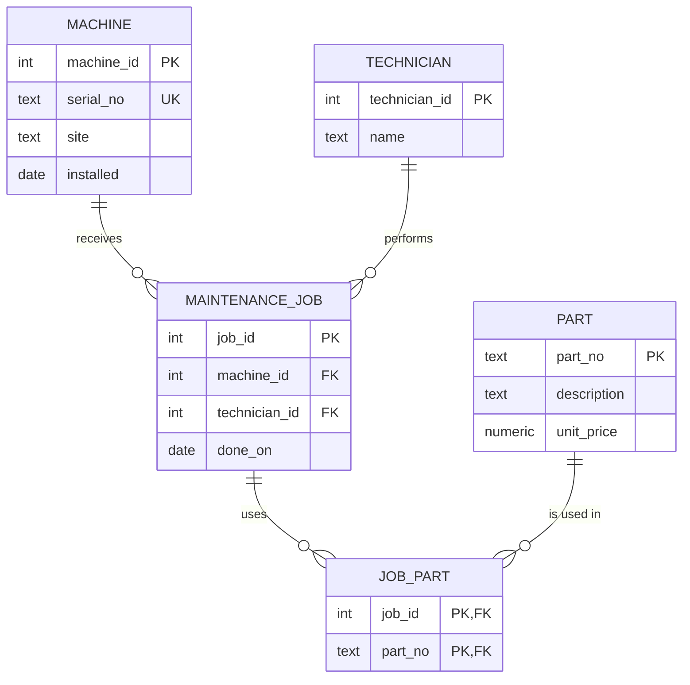

# ER audit of `legacy.db`

Rebuild: `sqlite3 Module02/legacy.db ".read Module02/legacy-setup.sql"` · Queries: [audit-queries.sql](audit-queries.sql) → [audit-results.txt](audit-results.txt)

## 1. Entities the designer meant to model

| Entity | Attributes | Intended key | What the legacy schema does |
|---|---|---|---|
| **Machine** | serial number, site, installation date | `machine_id` (surrogate) | no key at all; identified by a free-text `machine_name` |
| **Part** | part number, description, unit price | `part_no` (natural key) | `part_no` not `UNIQUE` → duplicate P-1003; price stored as `TEXT` |
| **MaintenanceJob** | date done, machine, technician | `job_id` | `machine_name` is a name, not a foreign key → orphan job on "cnc-05" |
| **Technician** | name (later: qualification, shift, contact) | `technician_id` | hidden as a plain name inside `maint_job` |
| **JobPart** (junction) | job, part (later: quantity) | (`job_id`, `part_no`) | hidden as a comma list in `parts_used` → violates 1NF |

**Surrogate vs. natural key.** For machines I choose a surrogate key (`machine_id`): names like "RANDOM-NAME" or "cnc-01" can change or be mistyped. For parts I keep the natural key `part_no` (the supplier's number is stable and meaningful), but it must be declared `PRIMARY KEY`/`UNIQUE`, otherwise it is not a key.

**Entity vs. attribute.** The technician is only a name today. As an entity, a technician gets one row with extra data (qualification, shift), and every job points to it, so "Beier" cannot be spelled two ways.

## 2. Reconstructed ER diagram

## 3. Cardinalities (proved with counts, see [audit-results.txt](audit-results.txt))

- **1:n Machine → MaintenanceJob:** one machine receives many jobs (cnc-01 has jobs 1 and 4); each job is done on exactly one machine. The legacy schema models this, but only through a name, without a foreign key.
- **m:n MaintenanceJob ↔ Part:** job 1 uses 2 parts (`n_parts = 2`), and part P-1001 appears in jobs 1 and 3. The legacy schema **hides** it in the text column `parts_used`; the fix is the junction table `JOB_PART`.
- **1:1:** the schema has none. A machine and its serial number are 1:1, so the serial number stays an attribute of the machine (with `UNIQUE`), not a separate entity.
